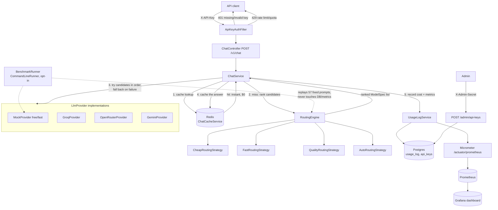

# Cost-Aware LLM Routing Service

A Spring Boot service that sits in front of multiple LLM providers (and a free, deterministic
mock provider) and routes each request to the cheapest/fastest/highest-quality model for the
caller's stated priority — with Redis caching, per-client API keys + rate limiting, cost/usage
tracking, Prometheus/Grafana observability, and a benchmark harness to quantify the savings.

## Architecture



Key point the diagram tries to make explicit: the **benchmark harness is a separate, dotted-line
path** — it reuses `RoutingEngine`/providers to measure realistic behavior, but deliberately never
writes to `usage_log` or Micrometer, so repeated benchmark runs can't pollute real usage stats or
the live dashboard (see [Design decisions](#design-decisions)).

## Project layout

```
src/main/java/com/example/llmrouter/
  chat/        POST /v1/chat controller, service, DTOs, Priority enum
  routing/     ModelRegistry (models.yml), RoutingStrategy impls, RoutingEngine
  provider/    LlmProvider interface + mock/groq/openrouter/gemini adapters (Resilience4j)
  cache/       Redis exact-match response cache
  apikey/      API key issuance + authentication
  ratelimit/   Redis fixed-window rate limiting/quota
  usage/       Cost calculation, usage_log persistence, /v1/usage, CostCalculator
  benchmark/   Fixed-prompt benchmark harness (Stage 9)
  error/       Global exception handling
```

## Setup

### Option A — one command, everything in Docker

```powershell
docker compose up -d --build
```

This builds the app image (multi-stage `Dockerfile`) and starts Postgres, Redis, Prometheus,
Grafana, and the app together, wired on one Docker network. The app is reachable at
`http://localhost:8080`, Grafana at `http://localhost:3000` (admin/admin), Prometheus at
`http://localhost:9090`.

Copy `.env.example` to `.env` first if you want real provider API keys, an admin secret, etc. —
`docker compose` automatically reads `.env` for the `${VAR:-default}` substitutions used in
`docker-compose.yml`.

### Option B — app on the host, infra in Docker (used throughout development)

```powershell
docker compose up -d postgres redis prometheus grafana
$env:JAVA_HOME = "C:\Program Files\Eclipse Adoptium\jdk-21.0.12.101-hotspot"
$env:Path = "$env:JAVA_HOME\bin;$env:Path"
.\mvnw.cmd spring-boot:run
```

### Running tests

```powershell
.\mvnw.cmd verify
```

`95/95` tests pass (unit tests + WireMock provider tests + Testcontainers Postgres/Redis
integration tests).

## Example requests

Create an API key (admin-only, requires `ADMIN_SECRET`):

```powershell
curl -X POST http://localhost:8080/admin/api-keys `
  -H "X-Admin-Secret: $env:ADMIN_SECRET" `
  -H "Content-Type: application/json" `
  -d '{"clientName":"demo-client","rateLimitPerMinute":30,"dailyQuota":500}'
```

Response includes the raw key once (`apiKey` field) — only its SHA-256 hash is stored.

Chat request, letting AUTO pick the model:

```powershell
curl -X POST http://localhost:8080/v1/chat `
  -H "X-API-Key: llmr_...` -H "Content-Type: application/json" `
  -d '{"prompt":"Summarize the French Revolution in two sentences.","priority":"AUTO"}'
```

Force the cheapest route:

```powershell
curl -X POST http://localhost:8080/v1/chat `
  -H "X-API-Key: llmr_..." -H "Content-Type: application/json" `
  -d '{"prompt":"hi","priority":"CHEAP"}'
```

Check your own cost/usage summary:

```powershell
curl http://localhost:8080/v1/usage -H "X-API-Key: llmr_..."
```

Raw Prometheus metrics:

```powershell
curl http://localhost:8080/actuator/prometheus
```

## Design decisions

- **Routing is pluggable per-priority, not a single scoring function.** `RoutingEngine` maps
  `Priority -> RoutingStrategy` (`CHEAP`/`FAST`/`QUALITY`/`AUTO`), and each strategy both `select()`s
  a single best candidate and `rank()`s all candidates so `ChatService` can fall back through the
  ordered list on failure, instead of hard-failing on the first provider's error.
- **Redis exact-match cache keys on normalized prompt + priority**, not raw prompt — trims/
  lowercases/collapses whitespace so trivial variations share a cache entry; a cache hit is
  recorded with `latencyMs=0`/`virtualCost=0` but still counts against the caller's rate limit
  (the filter runs before the cache is even checked, and rate limits protect the HTTP surface,
  a separate concern from provider cost).
- **API keys are stored as SHA-256 hashes only**; the raw key is returned once at creation and
  never persisted or logged. The admin endpoint itself is guarded by a separate, constant-time-
  compared `X-Admin-Secret` header (`MessageDigest.isEqual`) to avoid a timing side-channel.
- **Cost tracking computes two numbers per request**: `virtualCost` (what was actually spent —
  `0` on a cache hit or when the free mock/openrouter model answered) and `baselineCost` (what the
  most expensive configured model would have charged for the same tokens) — "savings" is always
  `baseline - virtual`, never its own stored field, so it can't drift from its two sources.
- **Metrics reuse the exact same already-computed cost values as `usage_log`** (same call site in
  `UsageLogService.record()`), instead of instrumenting each provider call separately — guarantees
  the dashboard and the `/v1/usage` API can never numerically disagree.
- **The benchmark harness does NOT write to `usage_log` or Micrometer.** It replays a fixed,
  repeatable 57-prompt set under every strategy purely to produce a report; routing it through the
  same recording path as real traffic would inflate real client usage stats and pollute the
  Grafana dashboard with fake, repeated request volume. It still calls the identical
  `CostCalculator`/`ModelRegistry.mostExpensive()` formula as production, so the cost *numbers*
  can't drift — only persistence is skipped. See `BenchmarkService`'s class javadoc for the full
  rationale.
- **Benchmarking is free and rate-limit-safe by default**: token counts come from the free local
  `MockProvider`, and non-mock candidates' latency is *simulated* by jittering `models.yml`'s
  already-"virtual, made-up" `avg-latency-ms` field (±15%, fixed seed for reproducibility) rather
  than making a real network call. Opting into `useRealProviders=true` calls real providers but
  gracefully falls back to the simulated path per-sample if a call fails (e.g. no API key).

## Benchmark results

**Mock-only run** (`BENCHMARK_ENABLED=true`, `BENCHMARK_USE_REAL_PROVIDERS=false` — the default;
zero real network calls, zero API cost), 57 fixed prompts replayed under all 5 strategies:

| strategy          | prompts | virtualCost$ | baselineCost$ | savings% | avgMs | p50Ms | p95Ms | realCalls |
|--------------------|--------:|-------------:|--------------:|---------:|------:|------:|------:|----------:|
| ALWAYS_EXPENSIVE   |      57 |       0.0746 |        0.0746 |     0.0% | 404.0 | 398.0 | 450.0 |         0 |
| CHEAP              |      57 |       0.0000 |        0.0746 |   100.0% | 176.8 | 172.0 | 296.0 |         0 |
| FAST               |      57 |       0.0000 |        0.0746 |   100.0% | 174.3 | 172.0 | 297.0 |         0 |
| QUALITY            |      57 |       0.0298 |        0.0746 |    60.0% | 601.9 | 607.0 | 679.0 |         0 |
| AUTO               |      57 |       0.0099 |        0.0746 |    86.7% | 297.0 | 251.0 | 660.0 |         0 |

> **Note on these numbers**: this environment has no real provider API keys configured, so a
> genuine "hybrid" run (`BENCHMARK_USE_REAL_PROVIDERS=true` with at least one real key present,
> producing `realCalls > 0` for non-mock strategies) was not captured here. These are the
> mock-only numbers — honest about what they are, not a substitute for a hybrid run. To produce
> one: set a real `GROQ_API_KEY`/`GEMINI_API_KEY`/`OPENROUTER_API_KEY` in `.env` and re-run with
> `BENCHMARK_USE_REAL_PROVIDERS=true`; expect `realCalls` to equal the prompt count for strategies
> that route to that provider (e.g. QUALITY → gemini), and latency/cost to reflect real API
> responses instead of simulated jitter for those rows.

Reading the table: `CHEAP`/`FAST` always route to the free mock model (100% savings, since it's
`$0`), `ALWAYS_EXPENSIVE` *is* the baseline by construction (always exactly 0% savings), `QUALITY`
always picks the one HIGH-quality-tier model (gemini, $0.02/1k — cheaper than the baseline groq at
$0.05/1k, hence a consistent 60% savings), and `AUTO` mixes strategies per prompt length/code-block
content, landing between the two extremes.

## Demo script

1. `docker compose up -d --build` — show all 5 containers come up healthy.
2. Create an API key via `/admin/api-keys`, highlight that the raw key is shown exactly once.
3. Send one `/v1/chat` request with `priority: QUALITY` — point out `routingReason`, `provider`,
   `model` in the response.
4. Repeat the exact same request — show `cacheHit: true`, `latencyMs: 0`.
5. Send requests past the configured rate limit — show the `429` + `Retry-After` header.
6. `GET /v1/usage` — show `totalSavings`/`savingsPercent` for that client.
7. Open Grafana (`localhost:3000`) — show requests/sec, cache hit rate, savings panels updating
   live.
8. Set `BENCHMARK_ENABLED=true` and restart the app (or run via `mvnw spring-boot:run`) — show the
   printed benchmark table and `benchmark-report.txt`, and explain why it doesn't appear in the
   Grafana dashboard or `/v1/usage` (see design decisions above).


